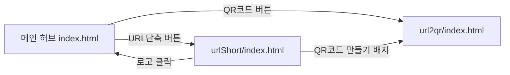
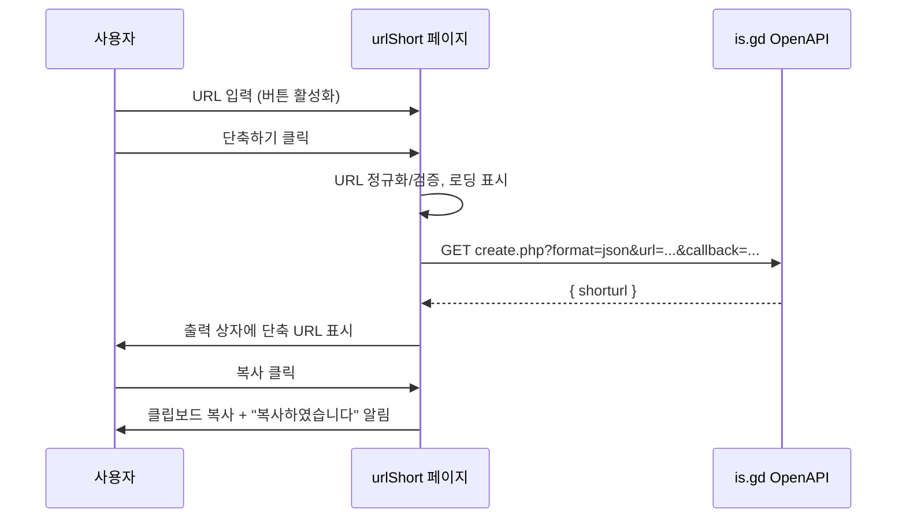

# Link Toolkit — 프로젝트 개요 및 기능 명세서

## 1. 프로젝트 개요

| 항목 | 내용 |
|---|---|
| 프로젝트명 | Link Toolkit (QR 코드 & URL 단축 웹 앱) |
| 목적 | 긴 URL을 **QR 코드**로 변환하거나 **짧은 URL**로 단축하는 올인원 링크 도구 |
| 기술 스택 | HTML5 · Vanilla CSS · Vanilla JavaScript (빌드/서버 불필요) |
| 외부 API | is.gd URL 단축 OpenAPI (fallback: v.gd) — API Key 불필요 |
| 실행 방법 | `index.html`을 브라우저로 열기 (file:// 실행 가능) |
| 디자인 | Toss · Linear · Vercel 참고 미니멀 디자인 (화이트 베이스, 블루 #3182F6 + 민트 #00C4A7 포인트) |

### 1-1. 폴더 구조

```text
프로젝트06/
├─ index.html            # 메인 허브 (QR코드 / URL단축 버튼)
├─ hub.css               # 공통 디자인 시스템 (허브 + urlShort 공용)
├─ PROJECT_SPEC.md       # 본 문서
├─ url2qr/               # [기존] QR 코드 생성기
│  ├─ index.html
│  ├─ css/style.css
│  ├─ js/app.js, qrcode.min.js
│  └─ img/
└─ urlShort/             # [신규] URL 단축기
   ├─ index.html
   ├─ css/style.css
   └─ js/app.js
```

### 1-2. 화면 흐름



---

## 2. 기능 명세

### F-01. 메인 허브 (`index.html`)

| ID | 기능 | 상세 | 요소 ID |
|---|---|---|---|
| F-01-1 | QR코드 버튼 | 클릭 시 `url2qr/index.html`로 이동 | `btnQrCode` |
| F-01-2 | URL단축 버튼 | 클릭 시 `urlShort/index.html`로 이동 | `btnUrlShort` |
| F-01-3 | 인터랙션 | 카드 hover 시 상승·아이콘 회전·화살표 이동 애니메이션 | — |

### F-02. QR 코드 생성기 (`url2qr/`, 기존)

| ID | 기능 | 상세 |
|---|---|---|
| F-02-1 | QR 생성 | URL 입력 후 Enter/확인 시 QR 코드 생성 |
| F-02-2 | JPG 다운로드 | QR 카드 클릭 또는 버튼으로 JPG 저장 |
| F-02-3 | 링크 복사 | 입력한 URL 클립보드 복사 |

### F-03. URL 단축기 (`urlShort/`, 신규)

| ID | 요구사항 | 기능 | 상세 동작 | 요소 ID |
|---|---|---|---|---|
| F-03-1 | 3-1 | URL 입력창 | 단축할 원본 URL 입력 | `urlInput` |
| F-03-2 | 3-1 | 단축하기 버튼 | 단축 요청 실행 (Enter 키도 동작) | `btnShorten` |
| F-03-3 | 3-1 | 읽기 전용 출력 상자 | `readonly` 속성, 결과 표시, 포커스 시 전체 선택 | `resultOutput` |
| F-03-4 | 3-2 | 버튼 비활성화 | 입력값이 공백/비어 있으면 `disabled`, 요청 중에도 비활성화 | `btnShorten` |
| F-03-5 | 3-3 | OpenAPI 단축 요청 | is.gd API에 JSONP 요청 → 응답 `shorturl`을 출력 상자에 표시 | — |
| F-03-6 | 3-4 | 복사 버튼 | 출력 상자 값을 클립보드에 자동 복사 | `btnCopy` |
| F-03-7 | 3-4 | 복사 알림창 | 복사 성공 시 **"복사하였습니다"** 알림(토스트) 2초 표시 | `toast` |
| F-03-8 | 추가 | URL 자동 보정 | `http(s)://` 누락 시 `https://` 자동 추가, 형식 검증 | — |
| F-03-9 | 추가 | 오류 처리 | 잘못된 URL / 타임아웃(8초) / 네트워크 오류 메시지 표시 | `errorMsg` |
| F-03-10 | 추가 | Fallback | is.gd 실패 시 v.gd로 자동 재시도 | — |
| F-03-11 | 추가 | 최근 기록 | 최근 5건을 localStorage에 저장, 개별 복사·전체 삭제 | `historyList` |

---

## 3. OpenAPI 명세

| 항목 | 내용 |
|---|---|
| Endpoint | `GET https://is.gd/create.php` (fallback `https://v.gd/create.php`) |
| 파라미터 | `format=json`, `url=<원본 URL>`, `callback=<JSONP 함수명>` |
| 성공 응답 | `callback({ "shorturl": "https://is.gd/EuvYes" })` |
| 실패 응답 | `callback({ "errorcode": 1, "errormessage": "..." })` |
| 호출 방식 | JSONP (`<script>` 동적 삽입) — CORS 제약 없이 브라우저/파일 실행 가능 |



---

## 4. 비기능 요구사항

| 구분 | 내용 |
|---|---|
| 호환성 | 최신 Chrome / Edge / Safari / Firefox |
| 반응형 | 560px 이하에서 입력·버튼 세로 배치 |
| 접근성 | `label` 연결, `aria-live` 결과/알림, `role="alert"` 오류 |
| 복사 호환성 | `navigator.clipboard` 우선, 미지원 시 `execCommand('copy')` fallback |
| 보안 | 기록 렌더링 시 `textContent` 사용(XSS 방지), 외부 링크 `noopener` |
