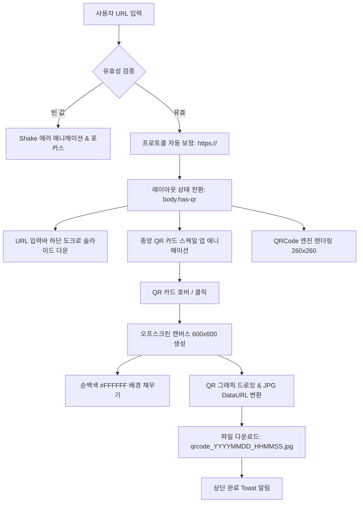

# QR 코드 생성기 (URL2QR) 프로젝트 문서

본 문서는 URL을 입력받아 즉시 QR 코드를 생성하고 JPG 파일로 다운로드할 수 있는 웹 애플리케이션의 **구현 계획**, **작업 목록(체크리스트)**, **상세 워크스루**를 정리한 기술 문서입니다.

---

## 1. 구현 계획 (Implementation Architecture & Plan)

### 1.1 프로젝트 목표
- **심플하고 직관적인 인터페이스**: URL 입력에 집중된 미니멀하고 세련된 레이아웃.
- **다이내믹 인터랙션**: 확인 시 입력창이 하단 도크로 슬라이드 다운되고 정중앙에 QR 코드가 생성되는 부드러운 상태 전환.
- **브랜드 일체형 비주얼 디자인**: `img/logo.png`(URL2QR 옐로우 로고)와 조화로운 화사한 웜 앰버 라이트 테마 및 마우스 커서 반응형 그라데이션.
- **신뢰할 수 있는 파일 다운로드**: 캔버스 오프스크린 렌더링을 통해 투명도 결함이 없는 순백색 고해상도 JPG 파일 저장.

### 1.2 시스템 아키텍처 및 데이터 흐름

### 1.3 기술 스택 및 구조
- **구조 (Markup)**: Semantic HTML5 ([index.html](file:///d:/D800.ViveCoding/프로젝트04/index.html))
- **스타일 (Styling)**: Vanilla CSS3, Glassmorphism, CSS Custom Properties ([css/style.css](file:///d:/D800.ViveCoding/프로젝트04/css/style.css))
- **스크립트 (Logic)**: Vanilla JavaScript ES6+, Canvas 2D Context API, Lerp Mouse Engine ([js/app.js](file:///d:/D800.ViveCoding/프로젝트04/js/app.js))
- **QR 엔진 (Engine)**: Standalone [js/qrcode.min.js](file:///d:/D800.ViveCoding/프로젝트04/js/qrcode.min.js) (오프라인 100% 독립 실행)
- **에셋 (Assets)**: [img/logo.png](file:///d:/D800.ViveCoding/프로젝트04/img/logo.png) (URL2QR 브랜딩)

---

## 2. 작업 목록 (Task List & Checklist)

### 2.1 요구사항 충족 현황
- [x] **화면 상단 좌측 로고 배치**: `img/logo.png` 연동 및 클릭 시 초기화 인터랙션 구현
- [x] **중앙 심플 URL 입력창**: 글래스모피즘 캡슐형 입력 바, 도메인 자동 보정, 클리어(X) 버튼
- [x] **상태 전환 애니메이션**: URL 확인 시 입력창 하단 이동 + 정중앙 QR 코드 등장
- [x] **고화질 JPG 파일 다운로드**: QR 카드 클릭 또는 [JPG 다운로드] 버튼 클릭 시 `.jpg` 파일 자동 다운로드
- [x] **로고 기반 밝은 톤 테마 리뉴얼**: URL2QR 옐로우 로고에 어울리는 웜 앰버 & 선셋 라이트 글래스모피즘 적용
- [x] **마우스 커서 반응형 그라데이션**: 커서 위치에 따라 조명 및 색조(Hue)가 유기적으로 변화하는 다이내믹 배경 엔진 탑재

### 2.2 세부 구현 체크리스트
| 영역 | 작업 항목 | 파일 링크 | 상태 |
| :--- | :--- | :--- | :---: |
| **마크업** | 시맨틱 헤더, 히어로, QR 카드, 입력바, 배경 레이어 구조화 | [index.html](file:///d:/D800.ViveCoding/프로젝트04/index.html) | ✅ 완료 |
| **마크업** | 인라인 `onsubmit` 간섭 제거 및 버튼 이벤트 분리 | [index.html](file:///d:/D800.ViveCoding/프로젝트04/index.html) | ✅ 완료 |
| **스타일** | 라이트 웜 앰버 컬러 토큰 & 글래스모피즘 정의 | [css/style.css](file:///d:/D800.ViveCoding/프로젝트04/css/style.css) | ✅ 완료 |
| **스타일** | 입력바 중앙 ↔ 하단 도크 스무스 트랜지션 (`cubic-bezier`) | [css/style.css](file:///d:/D800.ViveCoding/프로젝트04/css/style.css) | ✅ 완료 |
| **스타일** | 마우스 반응형 다이내믹 래디얼 그라데이션 및 블러 오브 | [css/style.css](file:///d:/D800.ViveCoding/프로젝트04/css/style.css) | ✅ 완료 |
| **스크립트** | 60fps 무지연 커서 추적 및 HSL 색조 시프트 엔진 (`requestAnimationFrame`) | [js/app.js](file:///d:/D800.ViveCoding/프로젝트04/js/app.js) | ✅ 완료 |
| **스크립트** | Enter 키 / 클릭 이벤트 다중 바인딩 및 폼 검증 | [js/app.js](file:///d:/D800.ViveCoding/프로젝트04/js/app.js) | ✅ 완료 |
| **스크립트** | 오프스크린 캔버스 기반 600x600 JPG 내보내기 및 토스트 알림 | [js/app.js](file:///d:/D800.ViveCoding/프로젝트04/js/app.js) | ✅ 완료 |
| **라이브러리** | 검증된 독립형 `qrcode.min.js` 로컬 배치 및 오프라인 보장 | [js/qrcode.min.js](file:///d:/D800.ViveCoding/프로젝트04/js/qrcode.min.js) | ✅ 완료 |

---

## 3. 워크스루 (Walkthrough)

### 3.1 화면 흐름 및 상태 변화

#### 1) 초기 진입 상태 (Initial State)
- 화면 좌측 상단에 **URL2QR 로고**와 **Instant Generator** 뱃지가 표시됩니다.
- 중앙에 **"간편하고 빠른 QR 코드 생성기"** 타이틀과 **심플한 URL 입력 바**가 위치합니다.
- 배경에는 마우스의 움직임에 따라 유영하는 따뜻한 골드 앰버와 피치 오렌지 조명이 반응합니다.

#### 2) QR 코드 생성 상태 (Active QR State)
- 사용자가 URL(예: `https://www.naver.com` 또는 `naver.com`)을 입력하고 **[확인] 버튼**이나 **Enter 키**를 누릅니다.
- `body`에 `.has-qr` 클래스가 추가되며 다음 모션이 동시에 일어납니다:
  - 히어로 타이틀이 부드럽게 페이드아웃됩니다.
  - URL 입력창이 화면 하단 28px 위치의 **고정 플로팅 도크(Bottom Dock)**로 슬라이드 다운됩니다.
  - 화면 정중앙에 **글래스모피즘 QR 카드**가 바운스 줌인되며 팝업됩니다.
- 하단 바에서 새로운 URL을 입력하고 확인을 누르면 QR 코드가 즉각 새로운 코드로 갱신됩니다.

#### 3) 인터랙티브 JPG 다운로드 & 복사
- QR 코드 카드에 마우스를 올리면 **프로스티드 글래스 오버레이**와 함께 **"클릭하여 JPG 다운로드"** 가이드가 나타납니다.
- **QR 카드 자체를 클릭**하거나 하단의 **[JPG 다운로드]** 버튼을 누르면:
  - 캔버스를 600x600 해상도의 순백색 배경 캔버스로 재가공하여 `qrcode_YYYYMMDD_HHMMSS.jpg` 파일로 저장됩니다.
  - 상단에 **"✨ JPG 파일로 다운로드되었습니다!"** Toast 알림이 팝업됩니다.
- **[링크 복사]** 버튼 클릭 시 클립보드에 URL이 복사됩니다.
- 좌측 상단 로고를 클릭하면 초기 중앙 입력창 상태로 리셋됩니다.

### 3.2 마우스 반응형 다이내믹 그라데이션 원리
- [js/app.js](file:///d:/D800.ViveCoding/프로젝트04/js/app.js)에서 마우스의 `(clientX, clientY)`를 추적하고 선형 보간(Lerp, 계수 0.085)으로 부드럽게 감속 추적합니다.
- 뷰포트 대비 커서 위치(`ratioX`, `ratioY`)에 따라 색조(Hue)를 실시간 계산합니다:
  - **Hue 1 (36° ~ 52°)**: 앰버 골드 ↔ 선샤인 옐로우
  - **Hue 2 (20° ~ 42°)**: 웜 선셋 오렌지 ↔ 소프트 피치
  - **Hue 3 (340° ~ 360°)**: 로즈 핑크 ↔ 코랄
- CSS 변수(`--mouse-x`, `--mouse-y`, `--glow-color-*`)를 실시간 업데이트하여 CSS 하드웨어 가속 다중 `radial-gradient`를 렌더링합니다.

---

## 4. 실행 및 테스트 방법

1. **브라우저 직접 실행**:
   - `d:\D800.ViveCoding\프로젝트04\index.html` 파일을 더블 클릭하여 실행합니다.
2. **로컬 개발 서버 실행**:
   - 브라우저 주소창에 `http://localhost:3000` 입력하여 접속합니다.
3. **새로고침 확인**:
   - 이미 창이 열려있는 경우 `Ctrl + F5`로 최신 스타일과 스크립트를 로드합니다.
